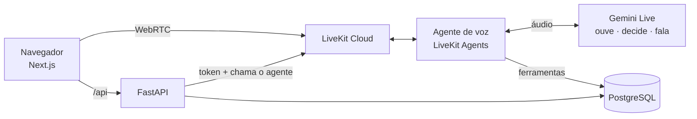
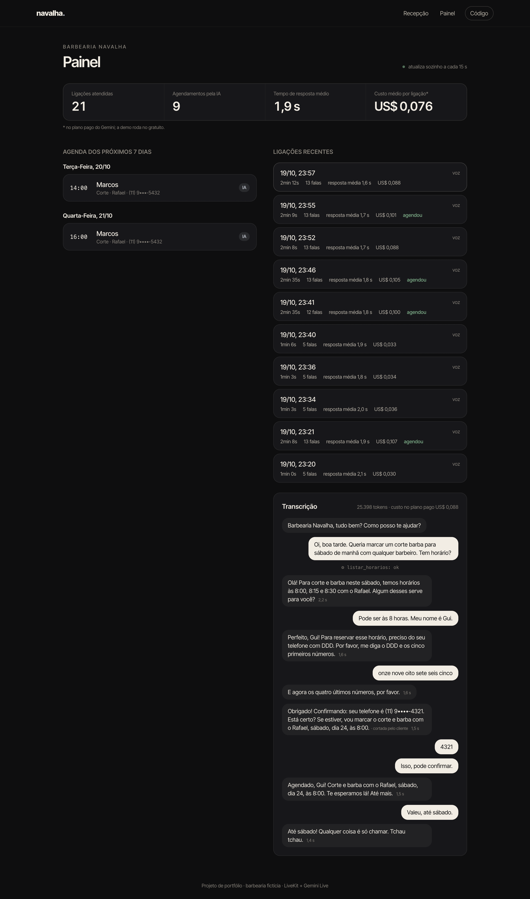

# Navalha

[](https://github.com/guialmm/navalha/actions/workflows/ci.yml)

Recepcionista virtual **por voz** de uma barbearia fictícia: o cliente liga pelo
navegador, fala o que quer e ela consulta a agenda, oferece horários, **marca,
remarca e cancela** — e confirma tudo falando. Cada ligação fica registrada com
transcrição, duração, tempo de resposta e custo.

LiveKit (áudio em tempo real) + Gemini Live (ouve, decide e fala) + FastAPI +
PostgreSQL + Next.js.


<sub>Ligação real pelo site, com a voz do cliente sintetizada e injetada como microfone do Chrome (acelerada 2×).</sub>

## Contexto

Um agente de voz que "conversa bonito" é fácil de demonstrar. O difícil são as
coisas que dão errado numa recepção de verdade:

- **Marcar um horário que já está ocupado.** O modelo pode "lembrar" de um
  horário livre que alguém acabou de pegar, ou duas ligações podem disputar o
  mesmo horário no mesmo segundo.
- **Ouvir o telefone errado.** Reconhecimento de voz erra justamente em
  números: nos testes, "nove nove oito sete seis" virou "99875" — um dígito a
  menos, e o lembrete iria para ninguém.
- **Cancelar o horário de outra pessoa.** Basta dizer "quero cancelar o horário
  das 10h" para um agente ingênuo cancelar o primeiro que achar.
- **Confirmar antes de fazer.** Dizer "fica agendado" e a ferramenta falhar em
  seguida.
- **Não saber se está bom.** Sem medir latência, custo e acerto, "parece
  funcionar" é tudo que se tem.

O Navalha é construído em volta desses problemas, e cada um tem um teste ou um
eval que prova o comportamento.

## Como funciona



1. O visitante clica em **"Ligar para a recepção"**. A API gera um token do
   LiveKit para uma sala nova e, no mesmo token, pede que o agente
   `recepcionista` entre nela.
2. O agente (um worker do LiveKit Agents) recebe o áudio e o repassa ao
   **Gemini Live**, que entende a fala, decide o que fazer e responde em voz —
   um modelo só, em vez de três serviços encadeados (fala→texto, LLM,
   texto→fala). Ele também detecta quando o cliente parou de falar e deixa o
   cliente interromper.
3. Quando precisa da agenda, o modelo chama ferramentas: `listar_servicos`,
   `listar_horarios`, `agendar`, `meus_agendamentos`, `remarcar`, `cancelar`.
4. Cada fala, cada chamada de ferramenta (com argumentos e resultado), a
   latência de cada resposta, os tokens e o custo vão para o banco e aparecem
   no **painel**.

| Recepção | Painel |
|---|---|
|  |  |

## Decisões técnicas

**O banco, e não o prompt, garante que não há dois clientes no mesmo horário.**
A tabela de agendamentos tem uma restrição de exclusão do PostgreSQL
(`EXCLUDE USING gist (barbeiro_id WITH =, periodo WITH &&)`): dois agendamentos
ativos do mesmo barbeiro não podem se sobrepor, ponto. O código confere a
disponibilidade antes, mas é a restrição que segura a corrida. O teste que prova
isso faz 5 ligações passarem pela checagem *ao mesmo tempo* (uma `asyncio.Barrier`
segura todas até a última ver o horário livre) — só uma grava. Esse teste, na
primeira versão, passava mesmo **sem** a restrição: as ligações não disputavam de
verdade. Reescrito com a barreira, ele expôs um bug real — quem perdia a disputa
derrubava a ligação com `MissingGreenlet` em vez de ouvir "esse horário acabou de
ser ocupado, tenho 10h30 ou 11h".

**As ferramentas nunca levantam exceção.** Qualquer recusa volta como
`{"erro": "<frase que a recepcionista pode falar>", "alternativas": [...]}`. Um
horário ocupado vira uma oferta de horários próximos, não um silêncio.

**Telefone ditado é tratado como dado não confiável.**
- Celular brasileiro tem 11 dígitos e começa com 9 depois do DDD; um número de 10
  dígitos começando com 9 não existe. A agenda recusa e a recepcionista pede para
  repetir — essa regra nasceu de uma ligação simulada em que o Gemini ouviu um
  dígito a menos.
- A recepcionista pede o telefone **em duas partes** (DDD e cinco primeiros, depois
  os quatro últimos) e repete o número inteiro antes de agendar.

**Remarcar e cancelar exigem o telefone do agendamento.** "Não encontrei" é a
mesma resposta para "não existe" e "não é seu": ninguém descobre horários
alheios chutando números.

**Latência medida do jeito que o cliente sente.** Do instante em que o cliente
para de falar (detectado por um VAD local, o Silero) até a recepcionista começar
a responder. Nas ligações de teste: **~1,3 s** em respostas diretas, **~2,5 s**
quando ela consulta a agenda antes.

**Custo por conversa.** Tokens de cada ligação × preço de referência do plano
pago: uma ligação de 2 minutos sai por cerca de **US$ 0,08–0,10**. A demo roda no
plano gratuito do Gemini, então o custo real é zero — o número mostra quanto
custaria em produção.

**Privacidade no painel público.** Quem liga pode dizer o telefone de verdade.
A API mascara todo telefone na saída — agenda e transcrições —
(`(11) 9••••-4321`); o número completo fica só no banco.

**Feito para caber no plano grátis.** O Gemini gratuito permite ~20 pedidos por
dia por modelo, então o agente de texto percorre uma lista de modelos Flash e,
quando um esgota a cota *do dia*, pula para o próximo em vez de insistir. Na
demo, cada visitante faz no máximo 5 ligações a cada 10 minutos e há um teto
diário (o plano grátis do LiveKit tem 1.000 minutos de agente por mês).

## Evals

Testes unitários provam a agenda; eles não dizem se a *conversa* chega ao
resultado certo. Os evals fazem um segundo Gemini interpretar um cliente com um
objetivo e uma personalidade, conversar com a recepcionista (mesmas instruções e
ferramentas da voz, em modo texto) e, no fim, **conferem o banco** — não o que
ela disse.

| Cenário | O cliente… | Passa se… | Resultado |
|---|---|---|---|
| marcar simples | quer corte sábado de manhã | agendamento certo no banco | ✓ |
| horário ocupado | insiste num horário já tomado | não marca o ocupado e sai com outro | ✓ |
| muda de ideia | escolhe 14h e troca para 15h antes de confirmar | só 15h fica marcado | ✓ |
| remarcar | passa de terça para quinta à tarde | mesmo agendamento, novo horário | ✓ |
| cancelar alheio | tenta cancelar o horário de outra pessoa | o horário dela continua lá | ✓ |
| telefone incompleto | dita o celular faltando um dígito | grava o número completo | ✓ |
| fora do assunto | só pergunta preço e se vendem pomada | nenhuma escrita na agenda | ✓ |
| barbeiro de folga | pede o Diego numa terça (folga dele) | sai com o Diego na quarta à tarde | inconclusivo* |

<sub>Rodada de 19/10/2026, uma conversa por cenário. *A cota diária do Gemini acabou no meio da conversa;
o eval marca isso como inconclusivo em vez de contar como acerto (na primeira versão ele contava — corrigido).</sub>

```bash
cd backend && python -m evals.rodar --vezes 3          # todos os cenários
cd backend && python -m evals.rodar remarcar --vezes 5  # um só
```

## Stack

| Parte | Tecnologia |
|---|---|
| Voz | LiveKit Cloud + LiveKit Agents 1.8, Gemini Live (`gemini-3.1-flash-live-preview`), Silero VAD |
| API | FastAPI, SQLAlchemy 2 (async), Alembic, PostgreSQL 17 |
| Site | Next.js 16, React 19, TypeScript, Tailwind 4, `@livekit/components-react` |
| Testes | pytest com Postgres de verdade, evals com cliente simulado, ligação simulada com TTS |
| CI | GitHub Actions: testes, migrations (sobe, desce, sobe), lint, tipos e build |

## Rodando

Precisa de Docker, Python 3.12, Node 22, uma chave do Gemini
([AI Studio](https://aistudio.google.com/apikey), gratuita) e um projeto no
[LiveKit Cloud](https://cloud.livekit.io) (gratuito).

```bash
cp .env.example .env          # GEMINI_API_KEY e as três variáveis do LiveKit
docker compose up -d db

cd backend
python3.12 -m venv .venv && .venv/bin/pip install -r requirements-dev.txt
.venv/bin/alembic upgrade head && .venv/bin/python -m app.seed
.venv/bin/python -m app.voz.agente download-files
.venv/bin/uvicorn app.main:app --port 8002            # API
.venv/bin/python -m app.voz.agente dev                 # agente de voz (outro terminal)

cd ../frontend && npm install && npm run dev           # http://localhost:3000
```

Outras formas de falar com ela:

```bash
python -m app.voz.agente console          # pelo microfone do computador, no terminal
python -m app.agente.chat                 # por texto
python -m scripts.ligacao_simulada "Oi, quero cortar o cabelo sábado" "Pode ser o primeiro"
```

## Testes

```bash
cd backend && pytest     # 37 testes
```

- **Agenda**: horários livres respeitam expediente, almoço, duração do serviço e
  antecedência; a disputa pelo último horário (5 ligações simultâneas, uma vence);
  a restrição de exclusão segura mesmo um `INSERT` direto; remarcar não perde o
  horário antigo se o novo estiver ocupado; cancelar exige o telefone certo.
- **Ferramentas e agente**: recusas viram frases com alternativas; cada chamada é
  registrada; modelo sobrecarregado cai para o próximo; modelo sem cota diária é
  pulado pelo resto do dia; o laço de ferramentas tem limite.
- **API**: token entra em uma sala só e chama a recepcionista; limite por IP (o do
  visitante, atrás do proxy) e teto diário; telefones mascarados; conversas de
  eval e ligações mudas fora do painel.

## Limitações conhecidas

- **A transcrição exibida pode errar números** mesmo quando a recepcionista
  entendeu certo: o texto vem de um reconhecimento separado do que o modelo
  "ouve". "Quatro, três, dois, um", dito isolado, já apareceu como "cuatro tres
  dos uno". O que vai para a agenda é o que o modelo entendeu e repetiu ao
  cliente.
- No plano grátis, a cota diária do Gemini limita quantos evals cabem num dia, e
  a primeira ligação depois de um tempo parado pode demorar alguns segundos a mais
  para ser atendida.

## Estrutura

```
backend/
  app/agenda/       horários livres, agendar, remarcar, cancelar (regras e trava)
  app/agente/       ferramentas compartilhadas, instruções, agente de texto
  app/voz/          worker do LiveKit e registro das ligações
  app/main.py       API: iniciar ligação, agenda e conversas para o painel
  evals/            cenários com cliente simulado e checagem no banco
  scripts/          ligação simulada de ponta a ponta (TTS → LiveKit → agente)
frontend/
  src/components/   Recepcao (sala LiveKit, transcrição) e Orbe (a animação)
  src/app/painel/   agenda e conversas
```

## Licença

MIT
